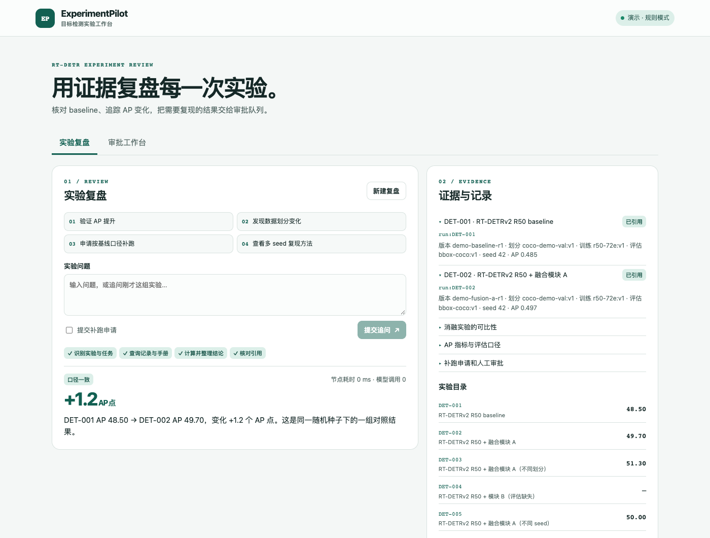
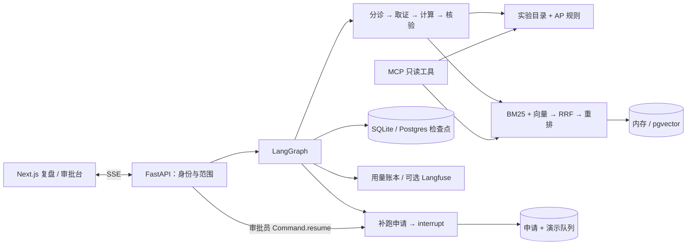

# ExperimentPilot

ExperimentPilot 为 RT-DETR / RT-DETRv2 实验组核对 baseline、复盘 AP 变化，并把需要复现的对照交给人工审批。实验员可以看到 Agent 的执行步骤、原始实验记录和手册引用。审批通过后，服务将指定版本和实验口径写入持久化队列。

[演示录屏](docs/demo.webm) · [离线评测报告](docs/offline-baseline.json) · [设计与取舍](docs/design-notes.md)



| 场景 | 可观察结果 |
| --- | --- |
| 对比 `DET-001` 和 `DET-002` | 48.50 → 49.70，报告 **+1.2 AP 点**并引用两条原始记录 |
| 对比 `DET-001` 和 `DET-003` | 数据划分不同，报告口径差异 |
| 对比 `DET-001` 和 `DET-004` | 评估口径和 AP 缺失，要求补证据 |
| 对上述不同划分的实验申请补跑 | 流程暂停，审批员核对版本和基线口径后决定是否入队 |

所有示例 AP 均为虚构数据。当前报告记录了 **100/100** 离线场景通过，包含引用和节点轨迹断言。测试集来自 20 个固定场景，每个有 5 种表述。另有 20 条注入、越权输入跑过真实 API 和工作流。离线数值只描述本项目的固定数据与规则模式。

## 运行

需要 Python 3.12+、uv、Node.js 22+。本地默认使用 SQLite、内存向量检索和固定规则，不用 API 密钥。

终端一运行 API。

```bash
cd experiment-pilot
uv run --locked uvicorn experiment_pilot.api:app --host 127.0.0.1 --port 8000
```

终端二运行工作台，访问 <http://127.0.0.1:3000>。

```bash
cd experiment-pilot/web
npm ci
npm run dev
```

先选「验证 AP 提升」并开始复盘，再选「申请按基线口径补跑」。到「审批工作台」选中申请，输入理由后批准或驳回。回到复盘页查看结果。API 文档在 <http://127.0.0.1:8000/docs>。

### PostgreSQL 和 pgvector

在装有 Docker Compose v2.24+ 的环境运行：

```bash
docker compose up --build --wait
```

Compose 启动 PostgreSQL + pgvector、FastAPI 和 Next.js。对外监听为本机 3000 端口。API 使用一个 worker 处理同一复盘的并发请求。Postgres 保存工作流检查点、补跑队列、用量与知识库向量。首次启动导入手册，后续只重嵌入内容或 embedding 标识有变化的条目。

`make compose-smoke` 会通过工作台代理验证 pgvector 检索、SSE、人工审批和审批重试。

### 导入 RT-DETR / RT-DETRv2 训练结果

导入命令读取 solver 输出目录里的 JSONL `log.txt`，按清单指定的 epoch 提取 COCO AP / AP_small。输出可直接配置为 `PILOT_RUNS_FILE`。导入详情、清单样例和防止误比的规则见 [实验日志导入](docs/import-rtdetr.md)。

### 使用真实实验记录和模型

复制 [.env.example](.env.example) 为 `.env`，按需配置。

- `PILOT_RUNS_FILE` 指向按 [runs.json](src/experiment_pilot/data/runs.json) 结构导出的受信 JSON。应用启动时读取，输入文件与模型输出隔离。AP 使用 0–1 比例。数据划分指纹、训练和评估口径必须由实验流水线生成或登记。训练口径应覆盖固定条件，消融项另由代码版本表达。
- `PILOT_SMALL_MODEL` 为无法用规则分流的问题分类，`PILOT_DRAFT_MODEL` 在允许的验证动作中选择一项，建议文案和引用由服务端生成。`PILOT_EMBEDDING_MODEL` 和 `PILOT_RERANK_URL` 可独立开启。`PILOT_MODEL_BASE_URL`、`PILOT_MODEL_KEY` 指向支持 JSON object 输出和所需 API 的服务。
- `PILOT_SMALL_PRICE` 和 `PILOT_DRAFT_PRICE` 是输入、输出各每百万 token 的 USD 价格。缺少价格或用量时，账本将成本记为未知。当前账本统计聊天调用，延迟包括本地节点内的检索时间。
- `PILOT_DEMO_AUTH=0` 时配置不同的实验员与审批员令牌，每个至少 24 字符。演示令牌用于本机虚构数据。
- 如需 Langfuse，使用 `uv sync --locked --extra observability`，配置 `PILOT_LANGFUSE=1` 与 Langfuse 凭证。追踪只记录节点、复盘和轮次 ID。

### 连接 MCP

MCP 使用 stdio。四个工具为 `list_runs`、`get_run`、`compare_experiments` 和 `search_handbook`。例如，从该子项目运行：

```bash
uv run --locked experiment-pilot-mcp
```

在 MCP 客户端中将命令设为 `uv`，参数设为 `--directory /绝对路径/experiment-pilot run --locked experiment-pilot-mcp`。关闭演示身份时，通过客户端环境设置 `PILOT_MCP_TOKEN`。MCP 和工作流共用实验目录、比较规则和检索器。

## 架构



请求中的两个编号按基线、候选排序。明确写「基线 DET-001」或「DET-002 相比 DET-001」时，按表达的方向解析。没有明确编号的追问可延续上一组有效对照。结构化补跑标记来自 API 表单，审批操作校验独立令牌。通过后，申请决策和队列记录在同一事务内落库。

### 公开部署

生产配置使用 Caddy HTTPS 和文件挂载的令牌。公开样例使用虚构数据，实验与审批工作台按角色授权。部署、TLS 验收、备份和回退见 [生产部署手册](docs/production.md)。

## 验证和评测

```bash
make check
uv run --locked python evals/run.py --split holdout
```

`make check` 运行后端检查、协议和安全测试、离线回归评测以及 Next.js 构建。详细评测可用 `--output` 指定保存位置。若已配置模型，可加 `--live-models --judge-model <模型名>`，单独生成带模型评审的报告。holdout 是固定场景下的不同表述，测试集本身来自同一批实验记录。

### 本地模型留出集

用已经安装的 Ollama 模型复现 [本地模型报告](docs/ollama-holdout.json)：

```bash
PILOT_MODEL_BASE_URL=http://127.0.0.1:11434/v1 \
PILOT_MODEL_KEY=ollama PILOT_SMALL_MODEL=deepseek-r1:7b \
PILOT_DRAFT_MODEL=deepseek-r1:7b PILOT_REASONING_EFFORT=none \
uv run --locked python evals/run.py --split holdout --live-models
```

该报告用真实聊天模型执行分流或建议选择，向量检索沿用本地固定方案。报告里的通过率来自规则断言和轨迹检查。本机 DeepSeek-R1 7B 运行通过 20/20，13 条调用了模型，11 条展示受控建议，端到端 P95 为 1.51 秒。测试集使用固定实验场景，结果不能外推到未覆盖的业务输入。

仓库根目录的 GitHub Actions 工作流运行回归和生产烟测。若将子项目独立成仓库，可复制 [独立仓库 CI 模板](deploy/github-actions.yml)。

## 目录

| 路径 | 职责 |
| --- | --- |
| `src/experiment_pilot/comparison.py`、`catalog.py` | 可比性规则、实验记录与作用域 |
| `graph.py`、`service.py`、`store.py` | 复盘图、轮次与重试、审批事务 |
| `retrieval.py`、`model.py`、`mcp_server.py` | 检索、模型接入、MCP 工具 |
| `api.py`、`web/` | FastAPI、SSE、复盘和审批页面 |
| `tests/`、`evals/`、`deploy/` | 协议和安全测试、场景评测、部署验证 |

已知边界包括单实验员和单审批员令牌、单 API worker、小型知识库、规则解析覆盖有限、以及补跑队列未接 GPU 调度器。带来源 ID 的模型建议仍需评估内容忠实度。生产配置、演示部署和验收操作见 [生产部署手册](docs/production.md)。

项目以 [SupportPilot 开题](https://aiinfra.blog/blog/agent-60/day-43-capstone-kickoff/) 和 [Day 54 作品验收](https://aiinfra.blog/blog/agent-60/day-54-capstone-packaging/) 为参考，代码与数据围绕目标检测实验重新实现。
